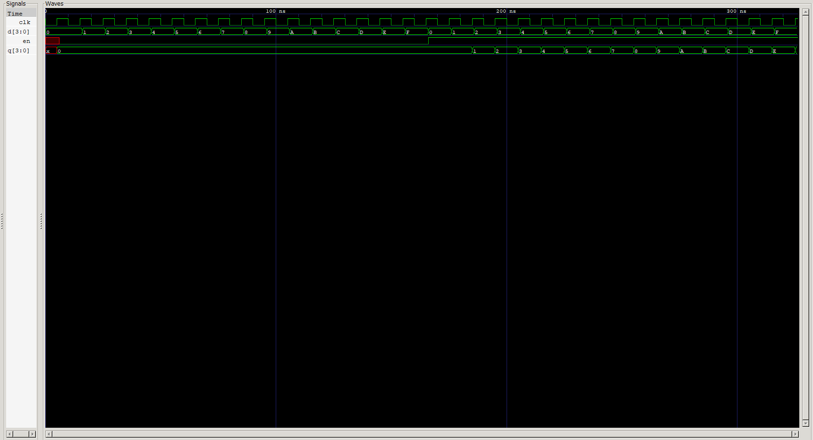

<div align="center">

# 🗄️ 4-Bit Register

### Parallel D-Flip-Flop Register with Load Enable · Verilog HDL

*Sequential Logic — [Verilog Fundamentals](#)*

[](#)
[](#)
[](#)
[](#)
[](#)

</div>

---

## 📖 Overview

This project implements a **4-bit parallel register** in Verilog HDL — the first *sequential* circuit in this repository, built entirely from four instantiated **D Flip-Flops** rather than a single behavioral always-block.

Unlike the combinational gates and ICs modeled so far, this register **holds state**. On every clock edge, it either **loads** a new 4-bit value or **retains** its current value — controlled by a single `en` (enable) signal.

> This is the moment the repository crosses from "logic that reacts instantly" to "logic that remembers" — the foundational building block behind registers, register files, and eventually a CPU's datapath.

**In this project you will:**

- 🔹 Build a 4-bit register from four reusable D Flip-Flop instances
- 🔹 Implement load-enable behavior using a multiplexer-style `assign`
- 🔹 Understand feedback paths (`q` routed back into its own input)
- 🔹 Practice structural module instantiation
- 🔹 Simulate synchronous, clocked behavior with Icarus Verilog
- 🔹 Verify load/hold transitions with GTKWave

---

## 📚 Prerequisites

| Topic | Why it matters |
|---|---|
| D Flip-Flop (`d_ff`) | The core storage element instantiated 4× |
| Continuous Assignment (`assign`) | Implements the load/hold selection logic |
| Conditional (Ternary) Operator (`? :`) | Selects between new data and held data |
| Module Instantiation | Structurally wires four flip-flops together |
| Clocked / Sequential Logic Basics | Understand edge-triggered behavior |
| Combinational Logic (Projects 01–06) | Contrast with this circuit's memory behavior |

---

## 🧠 Theory

A **register** is a group of flip-flops that store a multi-bit value and update it together, in parallel, on a clock edge.

This 4-bit register wraps **four independent D Flip-Flops**, one per bit, each fed not directly by the input `d`, but by a small piece of logic that decides *whether* to load new data:

$$d_i = \begin{cases} d[i] & \text{if } en = 1 \\ q[i] & \text{if } en = 0 \end{cases}$$

In Verilog, this is written per-bit as:

```verilog
assign d_0 = en ? d[0] : q[0];
```

When `en = 1`, the flip-flop's input is the new external data bit — so on the next clock edge, it **loads**.
When `en = 0`, the flip-flop's input is **its own current output**, `q[i]` — so on the next clock edge, it simply **re-latches its existing value**, i.e. it **holds**.

This feedback trick (`q` routed back into `d`) is what turns a plain D flip-flop into an *enable-controlled* storage cell without needing a separate enable pin inside the flip-flop itself.

---

## 📊 Behavior Table

| `en` | On Clock Edge | `q[i]` (next state) |
|:-:|---|:-:|
| `1` | **Load** | `d[i]` |
| `0` | **Hold** | `q[i]` *(unchanged)* |

This applies identically and independently to all four bits, `q[3:0]`.

---

## 🔌 Block Diagram

```
                      4-BIT REGISTER
                ┌─────────────────────────┐
                │                         │
     d[3:0] ───▶│   Load/Hold Selection    │
                │   (per-bit MUX logic)    │
                │            │             │
        en ────▶│            ▼             │
                │   ┌───────────────────┐  │
                │   │  FF0  FF1  FF2  FF3 │  │
                │   └───────────────────┘  │
       clk ────▶│            │             │
                │            ▼             │
                └─────────────────────────┘
                             │
                             ▼
                         q[3:0]
```

### Per-Bit Datapath (repeated ×4)

```
              en
               │
               ▼
        ┌─────────────┐
d[i] ──▶│             │
        │   en ? d[i] │
        │      : q[i] │──▶ d_i ──▶┌────────┐
q[i] ──▶│             │           │  D_FF  │──▶ q[i]
        └─────────────┘   clk ───▶│        │
                                   └────────┘
```

Each bit's flip-flop input is chosen between the new data bit and its own current output — the essence of a load-enable register.

---

## 💻 RTL Design

```verilog
module reg_4(
    input  [3:0] d,
    input        clk,
    input        en,
    output [3:0] q
);

    wire d_0, d_1, d_2, d_3;

    // Bit 0
    assign d_0 = en ? d[0] : q[0];
    d_ff ff0 (
        .d(d_0),
        .clk(clk),
        .q(q[0])
    );

    // Bit 1
    assign d_1 = en ? d[1] : q[1];
    d_ff ff1 (
        .d(d_1),
        .clk(clk),
        .q(q[1])
    );

    // Bit 2
    assign d_2 = en ? d[2] : q[2];
    d_ff ff2 (
        .d(d_2),
        .clk(clk),
        .q(q[2])
    );

    // Bit 3
    assign d_3 = en ? d[3] : q[3];
    d_ff ff3 (
        .d(d_3),
        .clk(clk),
        .q(q[3])
    );

endmodule
```

| Element | Purpose |
|---|---|
| `input [3:0] d` | 4-bit parallel data input |
| `input clk` | Shared clock, drives all four flip-flops together |
| `input en` | Load-enable — `1` loads, `0` holds |
| `output [3:0] q` | 4-bit stored value |
| `wire d_0 … d_3` | Internal nets carrying each flip-flop's selected input |
| `assign d_i = en ? d[i] : q[i];` | Per-bit load/hold selection logic |
| `d_ff ffN (...)` | Structural instantiation of one D Flip-Flop per bit |

---

## 🧩 Why Structural Instantiation?

Instead of writing one behavioral block like:

```verilog
always @(posedge clk) if (en) q <= d;
```

this design **explicitly instantiates four separate `d_ff` modules** and wires them by hand. This is a deliberate structural-design exercise:

<table>
<tr>
<td valign="top" width="50%">

**What it teaches**
- Module instantiation syntax
- Named port connections
- Building multi-bit circuits from single-bit primitives
- How a "register" is really just N flip-flops wired in parallel

</td>
<td valign="top" width="50%">

**Why it matters later**
- This is exactly how register files, pipeline stages, and datapath registers are composed in real RTL
- Reinforces that higher-level components are built from smaller, reusable, independently-testable blocks

</td>
</tr>
</table>

---

## 🧪 Testbench Strategy

A register testbench needs to verify **both** behaviors on the clock edge:

| Scenario | `en` | Expected Result |
|---|:-:|---|
| Load new data | `1` | `q` updates to match `d` on the next clock edge |
| Hold current data | `0` | `q` stays unchanged even if `d` changes |
| Load, then hold | `1` → `0` | `q` captures the loaded value and freezes it |
| Load again | `0` → `1` | `q` updates to the new `d` value |

A thorough testbench cycles `clk`, toggles `en`, and drives various `d` patterns — then checks that `q` only changes when `en` was high on the preceding clock edge.

---

## 🌊 Waveform Analysis



The waveform should demonstrate:

| Region | `en` | `d` | `q` behavior |
|---|:-:|---|---|
| Load phase | `1` | changing | `q` tracks `d` after each clock edge |
| Hold phase | `0` | changing (ignored) | `q` remains frozen at its last loaded value |
| Reload phase | `1` | new value | `q` updates again, confirming enable still works |

The clean separation between "load" and "hold" regions in the waveform is the key signature of correct enable-controlled register behavior.

---

## 📂 Project Structure

```
xx_4bit_register/
├── README.md
├── reg_4.v          # RTL design (this module)
├── d_ff.v            # D Flip-Flop primitive (dependency)
├── reg_4_tb.v         # Testbench
└── waveform.png          # GTKWave capture
```

---

## ▶️ How to Run

```bash
# 1. Compile design + D-FF dependency + testbench
iverilog -o reg_4.out reg_4.v d_ff.v reg_4_tb.v

# 2. Run the simulation
vvp reg_4.out

# 3. View waveform in GTKWave
gtkwave waveform.vcd
```

---

## 🌟 Applications

A parallel load-enable register is one of the most reused building blocks in digital design:

<table>
<tr>
<td valign="top" width="50%">

**Datapath & Processing**
- CPU register files
- Pipeline stage registers
- ALU input/output latching

</td>
<td valign="top" width="50%">

**Control & Storage**
- Configuration/status registers
- FIFO and buffer stages
- General-purpose data holding elements

</td>
</tr>
</table>

---

## 🎯 Key Concepts Learned

<table>
<tr>
<td valign="top" width="50%">

**Design Concepts**
- Sequential vs. combinational logic
- D Flip-Flop as a storage primitive
- Load-enable register behavior
- Feedback (`q` → `d`) for "hold" state

</td>
<td valign="top" width="50%">

**Verilog & Structure**
- Structural module instantiation
- Named port mapping
- Ternary operator (`? :`) for signal selection
- Multi-bit circuits from single-bit primitives

</td>
</tr>
</table>

---

## 📝 Learning Notes

This project was the first to introduce **state** into the repository — until now, every output was a pure function of the current inputs. Here, `q` depends on *history*: what was loaded the last time `en` was high.

The feedback trick — `assign d_i = en ? d[i] : q[i];` — was the key insight: rather than needing a flip-flop with a built-in enable pin, a plain D flip-flop can be made to "hold" simply by feeding its own output back into its input whenever loading isn't wanted.

Building the register **structurally**, instantiating four separate `d_ff` modules by hand, also reinforced how larger sequential components are composed from smaller, single-bit primitives — the same pattern used for register files and pipeline registers in real processor design.

**Skills reinforced:**
- Structural instantiation and port mapping
- Feedback-based state retention
- Bridging single-bit flip-flops into multi-bit registers
- Reasoning about behavior across clock edges rather than instantaneously

---

## 💼 Interview Questions

<details>
<summary><b>1. What is the function of the <code>en</code> signal in this register?</b></summary>
<br>

It controls whether the register **loads** new data (`en = 1`) or **holds** its current value (`en = 0`) on the next clock edge.
</details>

<details>
<summary><b>2. How does the design implement "hold" without a dedicated enable pin on the flip-flop?</b></summary>
<br>

By feeding the flip-flop's own output `q[i]` back into its input whenever `en = 0`:
```verilog
assign d_0 = en ? d[0] : q[0];
```
Re-latching the same value on the next clock edge is functionally identical to holding.
</details>

<details>
<summary><b>3. Why is this circuit sequential rather than combinational?</b></summary>
<br>

Because its output `q` depends on stored history (the value previously clocked in), not just the current inputs — and it only updates on clock edges, not instantaneously.
</details>

<details>
<summary><b>4. Why does this design instantiate four separate <code>d_ff</code> modules instead of using one behavioral <code>always</code> block?</b></summary>
<br>

To practice structural RTL design — building a multi-bit component explicitly from single-bit primitives, the same technique used to build register files and pipeline stages in real processor RTL.
</details>

<details>
<summary><b>5. What would happen if <code>en</code> changed between clock edges, mid-cycle?</b></summary>
<br>

Nothing would happen immediately — the register is edge-triggered, so `en`'s value only matters at the moment of the next active clock edge (whatever value it holds right before that edge determines load vs. hold).
</details>

<details>
<summary><b>6. Why are all four flip-flops driven by the same <code>clk</code> signal?</b></summary>
<br>

Because a register must update all its bits **synchronously and in parallel** — sharing one clock ensures all four bits change state together on the same edge, preserving the 4-bit value as a coherent whole.
</details>

<details>
<summary><b>7. What is the risk of a mismatched clock or enable path across the four bits?</b></summary>
<br>

If the bits didn't share the same clock/enable timing, the register could load only some bits on a given edge, producing a corrupted, partially-updated value instead of a clean 4-bit transition.
</details>

<details>
<summary><b>8. How would you extend this design to an 8-bit or 16-bit register?</b></summary>
<br>

By instantiating 8 or 16 `d_ff` modules instead of 4, widening the `d`/`q` ports accordingly, and repeating the same `en ? d[i] : q[i]` pattern per bit — the structure scales directly.
</details>

---

## 🚀 Next Project

### [Shift Register →](#)

Coming up:
- Serial-in, parallel-out (SIPO) behavior
- Shifting data between adjacent flip-flops
- Left/right shift direction control
- Building on the same D Flip-Flop primitive

---

<div align="center">

## 👨‍💻 Author

**Padma Charan S S**

**Repository:** Verilog Fundamentals · **Approach:** Project-Driven Learning

### 🗺️ Repository Roadmap

```
Basic Verilog → Logic Gates → 7400 Series ICs → Combinational Circuits
     → Sequential Logic → RTL Design → FPGA Design → Computer Architecture → CPU Design
```

*Every project teaches one new concept through practical implementation.*

---

> *"A register is where digital logic first learns to remember — four flip-flops, one shared clock, and a single enable bit standing between loading the future and holding the past."*

</div>