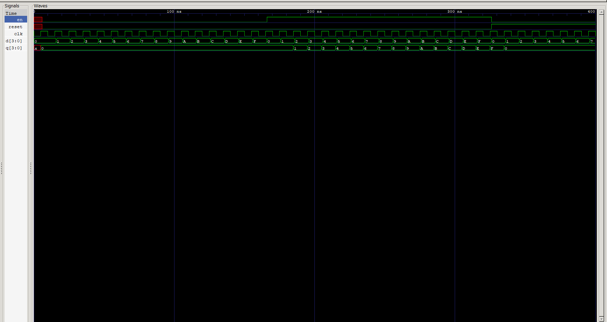

<div align="center">

# 🗄️ 4-Bit Register with Synchronous Reset

### Parallel D-Flip-Flop Register with Load Enable & Reset · Verilog HDL

*Sequential Logic — [Verilog Fundamentals](#)*

[](#)
[](#)
[](#)
[](#)
[](#)

</div>

---

## 📖 Overview

This project extends the earlier **4-bit register** by adding a **synchronous reset** input — the register now supports three behaviors instead of two: **reset**, **load**, and **hold**, all resolved on the clock edge with a clear priority order.

Like its predecessor, the register is built structurally from four instantiated **D Flip-Flops**, with a small piece of per-bit selection logic feeding each one. This project also introduces a fully **automated, self-checking testbench** that exhaustively sweeps all 64 combinations of `{reset, en, d}`.

> Reset is the control signal that makes a register *trustworthy* — without it, there's no reliable way to bring a design into a known state at power-up or after an error. This project shows exactly how that guarantee is built in hardware.

**In this project you will:**

- 🔹 Add synchronous reset to a 4-bit load-enable register
- 🔹 Establish signal **priority** — reset overrides enable, which overrides hold
- 🔹 Extend the per-bit ternary selection logic to three-way selection
- 🔹 Build a fully automated, self-checking testbench
- 🔹 Exhaustively verify all 64 possible `{reset, en, d}` combinations
- 🔹 Analyze reset, load, and hold transitions in GTKWave

---

## 📚 Prerequisites

| Topic | Why it matters |
|---|---|
| 4-Bit Register (previous project) | This project directly extends it |
| D Flip-Flop (`d_ff`) | The core storage element instantiated 4× |
| Continuous Assignment (`assign`) | Implements the reset/load/hold selection |
| Nested Ternary Operator (`? :`) | Encodes three-way priority logic |
| Module Instantiation | Structurally wires four flip-flops together |
| Self-Checking Testbenches | Automated PASS/FAIL verification |

---

## 🧠 Theory

This register still stores 4 bits across four D Flip-Flops, but each flip-flop's input is now chosen from **three** possible sources instead of two, with a strict priority:

$$d_i = \begin{cases} 0 & \text{if } reset = 1 \\ d[i] & \text{if } reset = 0 \text{ and } en = 1 \\ q[i] & \text{if } reset = 0 \text{ and } en = 0 \end{cases}$$

In Verilog, this is a **nested ternary**:

```verilog
assign d_0 = reset ? 1'b0 : (en ? d[0] : q[0]);
```

Read as: *"If reset is asserted, force 0. Otherwise, if enable is asserted, load the new bit. Otherwise, hold the current value."*

**Reset always wins.** Even if `en = 1` and new data is present, `reset = 1` forces the flip-flop's next-state input to `0` regardless of everything else.

---

## 📊 Behavior Table

| `reset` | `en` | On Clock Edge | `q[i]` (next state) |
|:-:|:-:|---|:-:|
| `1` | `×` | **Reset** | `0` |
| `0` | `1` | **Load** | `d[i]` |
| `0` | `0` | **Hold** | `q[i]` *(unchanged)* |

*(`×` = don't care — reset takes priority regardless of `en`)*

This priority order — **Reset > Enable > Hold** — applies identically and independently across all four bits.

---

## 🔌 Block Diagram

```
                      4-BIT REGISTER (with Reset)
                ┌───────────────────────────────┐
                │                               │
     d[3:0] ───▶│    Reset / Load / Hold          │
                │      Priority Selection          │
        en ────▶│              │                  │
                │              ▼                  │
     reset ────▶│   ┌───────────────────────┐    │
                │   │  FF0  FF1  FF2  FF3    │    │
                │   └───────────────────────┘    │
       clk ────▶│              │                  │
                │              ▼                  │
                └───────────────────────────────┘
                               │
                               ▼
                           q[3:0]
```

### Per-Bit Priority Logic (repeated ×4)

```
                    reset
                      │
                      ▼
             ┌─────────────────┐
             │  reset ?  0  :   │
d[i] ───────▶│  (en ? d[i]      │──▶ d_i ──▶┌────────┐
q[i] ───────▶│       : q[i])    │           │  D_FF  │──▶ q[i]
             └─────────────────┘   clk ───▶│        │
                                            └────────┘
```

Reset short-circuits the whole expression to `0` before enable is even considered — this is what gives it top priority.

---

## 💻 RTL Design

```verilog
module reg_4(
    input  [3:0] d,
    input        clk,
    input        en,
    input        reset,
    output [3:0] q
);

    wire d_0, d_1, d_2, d_3;

    // Bit 0
    assign d_0 = reset ? 1'b0 : (en ? d[0] : q[0]);
    d_ff ff0 (
        .d(d_0),
        .clk(clk),
        .q(q[0])
    );

    // Bit 1
    assign d_1 = reset ? 1'b0 : (en ? d[1] : q[1]);
    d_ff ff1 (
        .d(d_1),
        .clk(clk),
        .q(q[1])
    );

    // Bit 2
    assign d_2 = reset ? 1'b0 : (en ? d[2] : q[2]);
    d_ff ff2 (
        .d(d_2),
        .clk(clk),
        .q(q[2])
    );

    // Bit 3
    assign d_3 = reset ? 1'b0 : (en ? d[3] : q[3]);
    d_ff ff3 (
        .d(d_3),
        .clk(clk),
        .q(q[3])
    );

endmodule
```

| Element | Purpose |
|---|---|
| `input reset` | Synchronous, active-HIGH reset — highest priority |
| `assign d_i = reset ? 1'b0 : (en ? d[i] : q[i]);` | Three-way priority selection: reset → load → hold |
| `wire d_0 … d_3` | Internal nets carrying each flip-flop's selected input |
| `d_ff ffN (...)` | Structural instantiation of one D Flip-Flop per bit |

---

## 🧪 Testbench Strategy

The testbench is **fully automated and self-checking**, exhaustively sweeping the combined control space of `reset`, `en`, and `d`:

$$\{reset, en, d\} \rightarrow 2 \times 2 \times 2^4 = 2^6 = 64 \text{ combinations}$$

```verilog
localparam total_test_cases = 2**6;   // 64

for (i = 0; i < total_test_cases; i = i + 1) begin
    {reset, en, d} = i;   // sweeps every combination automatically
    @(posedge clk);
    ...
end
```

Packing all three control signals into a single 6-bit counter `i` is a compact way to guarantee **complete coverage** of the control space with one loop.

### Reference Model

```verilog
if (reset == 0) begin
    if (d && en)
        exp_q = d;
    else
        exp_q = exp_q;   // hold
end
else begin
    exp_q = 4'b0;
end
```

### Self-Checking Logic

For every one of the 64 iterations:

```verilog
if (exp_q == q)
    // PASS
else
    // FAIL — prints clk, d, en, reset, expected, and received values
```

A failure counter tracks mismatches, and the simulation ends with:

```
RESULT : ALL VALID TEST CASES PASSED
```

or a count of how many cases failed.

> 🔍 **Note on the reference model:** the condition `if (d && en)` treats an all-zero `d` (`d = 0000`) with `en = 1` as a "hold" case rather than a "load a zero" case — functionally harmless here since holding and loading zero look identical when `exp_q` is already `0`, but worth flagging as a subtlety in reference-model design: `d && en` and `en` alone are *not* logically equivalent, and a stricter model would use `en` on its own to decide load vs. hold.

---

## 🌊 Waveform Analysis



The waveform should clearly show three distinct regions:

| Region | `reset` | `en` | `q` behavior |
|---|:-:|:-:|---|
| Reset phase | `1` | any | `q` forced to `0000`, regardless of `d` or `en` |
| Load phase | `0` | `1` | `q` tracks `d` after each clock edge |
| Hold phase | `0` | `0` | `q` remains frozen at its last loaded value |

The clean, immediate drop to `0000` whenever `reset` goes high — overriding whatever `en` and `d` are doing — is the key signature of correctly prioritized reset logic.

---

## 📂 Project Structure

```
xx_4bit_register_reset/
├── README.md
├── reg_4.v          # RTL design (this module)
├── d_ff.v            # D Flip-Flop primitive (dependency)
├── reg_tb.v           # Automated self-checking testbench
└── waveform.png          # GTKWave capture
```

---

## ▶️ How to Run

```bash
# 1. Compile design + D-FF dependency + testbench
iverilog -o reg_tb.out reg_4.v d_ff.v reg_tb.v

# 2. Run the simulation
vvp reg_tb.out

# 3. View waveform in GTKWave
gtkwave waveform.vcd
```

A successful run reports:

```
4 Bit Register Automated Test Started
...
4 Bit Regsiter Automated test Ended
RESULT : ALL VALID TEST CASES PASSED
```

---

## 🌟 Applications

A resettable, load-enable register is one of the most fundamental building blocks in synchronous digital design:

<table>
<tr>
<td valign="top" width="50%">

**Initialization & Safety**
- Power-on / power-up reset logic
- Bringing a system to a known state after error
- Safe FSM re-initialization

</td>
<td valign="top" width="50%">

**Datapath & Storage**
- CPU register files with reset
- Pipeline registers cleared on flush
- Configuration/status registers

</td>
</tr>
</table>

---

## 🎯 Key Concepts Learned

<table>
<tr>
<td valign="top" width="50%">

**Design Concepts**
- Synchronous reset vs. asynchronous reset
- Signal priority (reset > enable > hold)
- Nested ternary logic for multi-way selection
- Structural instantiation of storage primitives

</td>
<td valign="top" width="50%">

**Verification & Tooling**
- Compact exhaustive coverage via bit-packed loop counters
- Independent reference-model construction
- Self-checking testbench design
- Icarus Verilog & GTKWave workflow

</td>
</tr>
</table>

---

## 📝 Learning Notes

This project introduced **signal priority** as a new design concern — with three competing behaviors (reset, load, hold) all resolved on the same clock edge, the *order* in which conditions are checked matters just as much as the conditions themselves. Nesting the ternary so `reset` is evaluated first, before `en` is even considered, is what guarantees reset always wins.

Packing `{reset, en, d}` into a single loop variable `i` running from `0` to `63` was a neat trick for guaranteeing full 6-bit coverage without three nested loops — a pattern worth remembering for future multi-signal exhaustive testbenches.

The subtlety in the reference model (`d && en` vs. plain `en`) was also a useful reminder that a self-checking testbench is only as trustworthy as its reference logic — even a "self-checking" test can quietly encode the same assumption as the design it's checking, so it's worth re-reading reference models with a critical eye.

**Skills reinforced:**
- Priority encoding in combinational selection logic
- Exhaustive coverage via bit-packed test loops
- Structural instantiation and port mapping
- Critical reading of testbench reference models

---

## 💼 Interview Questions

<details>
<summary><b>1. What is the priority order among reset, enable, and hold in this design?</b></summary>
<br>

**Reset > Enable > Hold.** Reset is checked first in the ternary expression and forces the flip-flop input to `0` regardless of the enable or data signals.
</details>

<details>
<summary><b>2. Is this reset synchronous or asynchronous? How can you tell?</b></summary>
<br>

Synchronous — the reset value only takes effect through the flip-flop's `d` input, which is only sampled on the clock edge (inside `d_ff`). An asynchronous reset would instead directly force `q` to `0` independent of the clock, typically via a dedicated reset port on the flip-flop itself.
</details>

<details>
<summary><b>3. Why is the ternary expression nested as <code>reset ? 0 : (en ? d[i] : q[i])</code> rather than some other order?</b></summary>
<br>

Because Verilog evaluates the outer condition first — putting `reset` as the outermost check guarantees it overrides everything else. Reordering it (e.g., checking `en` first) would let enable "win" over reset, which is the opposite of the intended safety behavior.
</details>

<details>
<summary><b>4. How does the testbench achieve exhaustive coverage of <code>reset</code>, <code>en</code>, and <code>d</code> together?</b></summary>
<br>

By packing all three signals into a single 6-bit value (`{reset, en, d}`) and looping a counter `i` from `0` to `63` (2⁶ − 1), assigning `{reset, en, d} = i` each iteration — this sweeps every combination without needing nested loops.
</details>

<details>
<summary><b>5. What subtlety exists in the reference model's <code>if (d &amp;&amp; en)</code> condition?</b></summary>
<br>

`d && en` is a reduction check on `d` combined with `en` — it only treats the case as a "load" when `d` is nonzero *and* `en` is high. When `d = 0000` and `en = 1`, this technically falls into the "hold" branch instead of "load," though the result is indistinguishable from loading a zero when the held value is already zero.
</details>

<details>
<summary><b>6. Why does a register typically need a reset signal at all?</b></summary>
<br>

To bring the circuit into a known, defined state — at power-up, flip-flops can start in an unpredictable state, and without reset there's no reliable way to guarantee the system begins operation correctly.
</details>

<details>
<summary><b>7. What would change in the RTL if reset needed to be asynchronous instead of synchronous?</b></summary>
<br>

The reset logic would need to move into the `d_ff` module itself, using a sensitivity list like `always @(posedge clk or posedge reset)` so that reset can force `q` to `0` immediately, independent of the clock edge — rather than being folded into the `d` input as combinational logic.
</details>

<details>
<summary><b>8. Why are all four bits' reset/enable logic identical and independent?</b></summary>
<br>

Because each bit is stored in its own flip-flop with its own selection logic — the register has no cross-bit dependencies, so the same reset-priority pattern is simply repeated four times, once per bit.
</details>

---

## 🚀 Next Project

### [Shift Register →](#)

Coming up:
- Serial-in, parallel-out (SIPO) behavior
- Shifting data between adjacent flip-flops
- Left/right shift direction control
- Combining reset, enable, and shift control in one register

---

<div align="center">

## 👨‍💻 Author

**Padma Charan S S**

**Repository:** Verilog Fundamentals · **Approach:** Project-Driven Learning

### 🗺️ Repository Roadmap

```
Basic Verilog → Logic Gates → 7400 Series ICs → Combinational Circuits
     → Sequential Logic → RTL Design → FPGA Design → Computer Architecture → CPU Design
```

*Every project teaches one new concept through practical implementation.*

---

> *"Reset is what turns a register from something that merely stores a value into something you can trust to start from zero, every single time."*

</div>