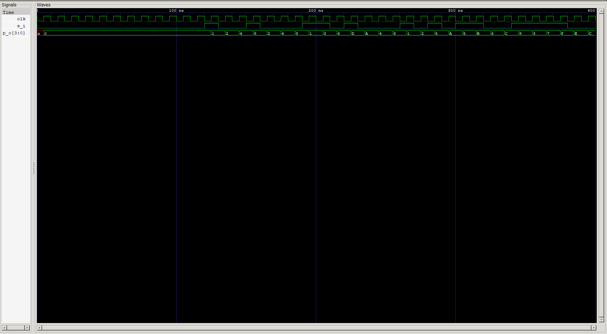

<div align="center">

# ⏩ SIPO Shift Register

### 4-Bit Serial-In Parallel-Out Shift Register · Verilog HDL

*Sequential Logic — [Verilog Fundamentals](#)*

[](#)
[](#)
[](#)
[](#)
[](#)
[](#)

</div>

---

## 📖 Overview

This project implements a **4-bit Serial-In Parallel-Out (SIPO) shift register** in Verilog HDL. Bits arrive **one at a time** on a single serial input `s_i`, shift through a chain of four D Flip-Flops, and every stage is exposed at once as a 4-bit **parallel output** `p_o`.

It is the same flip-flop chain as the SISO register, with one change: instead of tapping only the last stage, the whole internal bus `q` is wired out to the port. That single change turns a delay line into a **serial-to-parallel converter** — four clock cycles of serial data go in, and one complete 4-bit word comes out.

> Serial links carry data one bit at a time, but processors work on whole words. The SIPO register is the bridge between the two.

The testbench is also stronger than the SISO one: because the output is the **full parallel word**, a single comparison after four shifts validates *all four stages* at once.

**In this project you will:**

- 🔹 Convert a serial bit stream into a parallel word
- 🔹 Understand how exposing internal state (`assign p_o = q`) changes a design's function
- 🔹 See how bit ordering (MSB-first) maps onto `q[3:0]`
- 🔹 Build a self-checking testbench with a software reference shift register
- 🔹 Verify all 16 possible 4-bit words end to end

---

## 📚 Prerequisites

| Topic | Why it matters |
|---|---|
| D Flip-Flop (`d_ff`) | The storage element chained 4× |
| SISO Shift Register (previous project) | Same chain, different output tap |
| Structural Module Instantiation | Wires each flip-flop output into the next |
| Vectors & Concatenation | `{exp_q[2:0], s_i}` models the shift |
| Negedge-drive / Posedge-sample Testbench Timing | Race-free stimulus |
| Self-Checking Testbenches | Automated PASS/FAIL verification |

---

## 🧠 Theory

A **SIPO shift register** accepts data serially and presents it in parallel. Like every shift register, each flip-flop's output feeds the next flip-flop's input and all stages share one clock, so on every clock edge each bit moves one position down the chain.

The difference from SISO is purely at the **output**:

| Register | Serial Input | Output Tap |
|---|:-:|---|
| **SISO** | `s_i` | Last stage only (`s_o = q[3]`) |
| **SIPO** | `s_i` | **Every stage** (`p_o = q[3:0]`) |

### Per-Stage Equations

$$q[0]_{next} = s\_i \qquad q[i]_{next} = q[i-1] \;\; (i = 1,2,3) \qquad p\_o = q[3:0]$$

In shift notation, on every clock edge:

```verilog
q <= {q[2:0], s_i};   // newest bit enters at q[0], everything else moves up
```

### Bit Ordering

The newest bit always enters at `q[0]`, so the **first bit sent ends up at `q[3]`** after four clocks. This means sending a word **MSB first** reconstructs it exactly:

```
Word to send:   1 0 1 1   (MSB first)
After 4 clocks: q[3] q[2] q[1] q[0] = 1 0 1 1   →   p_o = 1011  ✅
```

> ⚠️ Sending the same word **LSB first** would produce the bit-reversed word on `p_o`. Serial protocols must agree on bit order for exactly this reason.

---

## 🔬 Shift Behavior Example

Serial stream (MSB first): `1 → 0 → 1 → 1`, starting from `q = 0000`:

| Clock Edge | `s_i` | `q[3]` | `q[2]` | `q[1]` | `q[0]` | `p_o` |
|:-:|:-:|:-:|:-:|:-:|:-:|:-:|
| Initial | — | 0 | 0 | 0 | 0 | `0000` |
| 1 | 1 | 0 | 0 | 0 | 1 | `0001` |
| 2 | 0 | 0 | 0 | 1 | 0 | `0010` |
| 3 | 1 | 0 | 1 | 0 | 1 | `0101` |
| 4 | 1 | 1 | 0 | 1 | 1 | **`1011`** ✅ |

After exactly four clock edges, `p_o` holds the complete word that was sent serially.

```
Serial in :  1 → 0 → 1 → 1          (4 clock cycles)
                     │
                     ▼
Parallel out:      1 0 1 1           (available all at once)
```

> 💡 The intermediate values (`0001`, `0010`, `0101`) are **in-flight partial words**. `p_o` is only meaningful once every four clocks — real systems pair a SIPO register with a bit counter or a "data valid" strobe to know when the word is complete.

---

## 🔌 Block Diagram

```
                      4-BIT SIPO SHIFT REGISTER
        ┌─────────────────────────────────────────────────────┐
        │                                                     │
        │   ┌───────┐   ┌───────┐   ┌───────┐   ┌───────┐     │
 s_i ──▶│──▶│ D_FF0 │──▶│ D_FF1 │──▶│ D_FF2 │──▶│ D_FF3 │     │
        │   └───┬───┘   └───┬───┘   └───┬───┘   └───┬───┘     │
        │    q[0]│       q[1]│       q[2]│       q[3]│         │
 clk ──▶│  (all four flip-flops share the clock)    │         │
        │        │           │           │           │         │
        └────────┼───────────┼───────────┼───────────┼─────────┘
                 ▼           ▼           ▼           ▼
              p_o[0]      p_o[1]      p_o[2]      p_o[3]
                 └───────────┴─────┬─────┴───────────┘
                                   ▼
                              p_o[3:0]  (parallel word)
```

Compared with the SISO block diagram, the only addition is that **every** flip-flop output is brought out to the port.

---

## 💻 RTL Design

```verilog
module sipo (
    input        s_i,
    input        clk,
    output [3:0] p_o
);

    wire [3:0] q;

    d_ff p_0 ( .d(s_i),  .clk(clk), .q(q[0]) );   // Stage 0: fed by serial input
    d_ff p_1 ( .d(q[0]), .clk(clk), .q(q[1]) );   // Stage 1
    d_ff p_2 ( .d(q[1]), .clk(clk), .q(q[2]) );   // Stage 2
    d_ff p_3 ( .d(q[2]), .clk(clk), .q(q[3]) );   // Stage 3

    assign p_o = q;   // expose every stage as the parallel output

endmodule
```

| Element | Purpose |
|---|---|
| `input s_i` | Single serial data input |
| `output [3:0] p_o` | 4-bit parallel output — the assembled word |
| `wire [3:0] q` | Internal bus carrying every stage's output |
| `d_ff p_N (...)` | Explicit instance per stage, each fed by the previous stage |
| `assign p_o = q;` | The one line that makes this SIPO instead of SISO |

> 💡 The four instances are written out by hand here. The same chain could be built with the `generate` / `genvar` loop from the SISO project — worth trying as a refactor, since changing the width then becomes a one-number edit.

---

## 🧪 Testbench Strategy

The testbench is fully automated and self-checking.

### Stage 1 — Flush the Register

The design has **no reset**, so flip-flops start as unknown (`x`). Four `0`s are shifted in to clear them:

```verilog
exp_q = 4'bxxxx;

repeat (4) begin
    @(negedge clk);
    s_i = 0;
    @(posedge clk);
    #1;
end

exp_q = 4'b0;   // reference model now matches the hardware
```

Four clocks are enough because the chain is four stages deep — every `x` is pushed out.

### Stage 2 — Sweep All 16 Words

```
2⁴ = 16 words   (0000 → 1111)
```

Each word is sent **MSB first**, one bit per clock:

```verilog
localparam total_test_cases = 2**4;   // 16

for (i = 0; i < total_test_cases; i = i + 1) begin
    test_data = i;
    for (j = 3; j >= 0; j = j - 1) begin
        @(negedge clk);
        s_i = test_data[j];
        @(posedge clk);
        exp_q = {exp_q[2:0], s_i};
        #1;
        exp_p_o = exp_q;
    end
    ...
end
```

### Stage 3 — Race-Free Timing

```
          negedge          posedge     +1 ns
             │                │          │
 drive s_i ──┘      DUT samples s_i      └── check p_o
```

| Step | Why |
|---|---|
| Drive `s_i` on **negedge** | Input is stable well before the active edge — no setup/hold race |
| Update reference on **posedge** | Reference model shifts at the same instant as the DUT |
| Wait `#1` before reading | Lets the flip-flop outputs settle after the clock edge |

### Stage 4 — Software Reference Model

```verilog
exp_q   = {exp_q[2:0], s_i};   // shift in software
exp_p_o = exp_q;               // expected parallel word
```

A plain concatenation shift acts as an **independent golden model** — a different implementation of the same behavior than the DUT's chained flip-flops.

### Self-Checking

After the fourth bit of each word, the whole parallel output is compared:

```verilog
if (exp_p_o == p_o)
    // PASS
else
    // FAIL — prints clk, s_i, expected, and received
```

A failure counter feeds the final summary:

```
RESULT : ALL VALID TEST CASES PASSED
```

---

## 🌊 Waveform Analysis



The waveform should show:

| Observation | What to look for |
|---|---|
| Flush phase | `s_i = 0` for four clocks while `p_o` settles from `xxxx` to `0000` |
| Serial input | `s_i` changing once per clock, on the falling edge |
| Staircase fill | Each new bit entering `p_o[0]` and every earlier bit moving up one position |
| Word complete | After every fourth clock, `p_o` equals the word that was just sent |

Watching `p_o` fill from the bottom bit upward — `0001 → 0010 → 0101 → 1011` — is the signature of a working serial-to-parallel converter.

---

## 🔍 Verification Notes

<details>
<summary><b>🔎 Why this check is stronger than the SISO check</b></summary>
<br>

In the SISO testbench, the single output bit `s_o` only reflected one stage (`q[3]`), so one comparison per pattern validated one flip-flop's value. Here the comparison is on the **entire 4-bit word**, so a single check after four shifts validates every stage and the ordering between them. A stuck bit, a swapped stage, or a missing connection anywhere in the chain would show up as a mismatch.
</details>

<details>
<summary><b>🔎 What isn't compared</b></summary>
<br>

The PASS/FAIL check runs once per 4-bit word, after the final bit is shifted in. The partial words during the first three shifts of each pattern are modeled by `exp_p_o` (updated every clock) but not individually compared against `p_o`. A stricter variant would move the `if (exp_p_o == p_o)` check inside the inner `j` loop, validating the output on every clock edge — **64 comparisons instead of 16**.
</details>

<details>
<summary><b>🔎 Why the flush stage is necessary</b></summary>
<br>

Without a reset, the flip-flops start at `x` in simulation. If the reference model started at `0000` while the DUT started at `xxxx`, early comparisons would fail for the wrong reason. Flushing both with four known `0`s synchronizes the DUT and the reference model before real testing begins.
</details>

---

## 📂 Project Structure

```
xx_sipo_shift_register/
├── README.md
├── sipo.v          # RTL design (this module)
├── d_ff.v           # D Flip-Flop primitive (dependency)
├── sipo_tb.v         # Automated self-checking testbench
└── waveform.png         # GTKWave capture
```

---

## ▶️ How to Run

```bash
# 1. Compile design + D-FF dependency + testbench
iverilog -o sipo_tb.out sipo.v d_ff.v sipo_tb.v

# 2. Run the simulation
vvp sipo_tb.out

# 3. View waveform in GTKWave
gtkwave waveform.vcd
```

A successful run ends with:

```
SIPO Shift Register Automated Test Started
...
SIPO Shift Regsiter Automated test Ended
RESULT : ALL VALID TEST CASES PASSED
```

---

## 🌟 Applications

<table>
<tr>
<td valign="top" width="50%">

**Communication Interfaces**
- UART / SPI / I²C receive paths
- Serial-to-parallel data conversion
- Deserializers in high-speed links

</td>
<td valign="top" width="50%">

**I/O & Control**
- Expanding few microcontroller pins into many outputs (e.g., 74HC595-style devices)
- Driving LED rows and display drivers
- Capturing serial sensor data into a word

</td>
</tr>
</table>

---

## 🎯 Key Concepts Learned

<table>
<tr>
<td valign="top" width="50%">

**Design Concepts**
- Serial-to-parallel conversion
- Exposing internal state as an output
- MSB-first vs. LSB-first bit ordering
- In-flight vs. complete words (data validity)

</td>
<td valign="top" width="50%">

**Verilog & Verification**
- Structural chaining of flip-flops
- Bus-level `assign p_o = q;`
- Negedge-drive / posedge-sample timing
- Flush-based initialization of reset-less designs
- Whole-word reference-model comparison

</td>
</tr>
</table>

---

## 📝 Learning Notes

The most striking thing about this project is how **small the change is** from SISO: the chain is identical, and one line — `assign p_o = q;` — changes what the circuit *does*. Same hardware, different observation point, completely different function. That was a useful lesson in how much of a design's behavior depends on which signals you choose to expose.

Working through the bit ordering was the other key step. Because the newest bit enters at `q[0]`, the first bit sent travels all the way to `q[3]`, so MSB-first transmission reassembles the original word. It was a concrete demonstration of why serial protocols have to specify bit order.

It also raised a real design question: `p_o` changes every clock, but is only a *valid word* every fourth clock. In a real receiver, something else — a bit counter or a valid strobe — has to tell the rest of the system when to read it.

**Skills reinforced:**
- Reasoning about serial-to-parallel data flow
- Choosing output taps to define circuit function
- Bit-ordering awareness in serial systems
- Race-free testbench timing
- Building an independent software reference model

---

## 💼 Interview Questions

<details>
<summary><b>1. What does SIPO stand for, and what does it do?</b></summary>
<br>

**Serial-In Parallel-Out.** It accepts one bit per clock on a serial input and, after N clocks, presents all N bits at once on a parallel output — a serial-to-parallel converter.
</details>

<details>
<summary><b>2. What is the only structural difference between this SIPO and the SISO register?</b></summary>
<br>

The output tap. SISO brings out only the last flip-flop (`s_o = q[3]`), while SIPO brings out every flip-flop (`p_o = q`). The flip-flop chain itself is identical.
</details>

<details>
<summary><b>3. After how many clock cycles is the parallel output valid, and why?</b></summary>
<br>

After **four** clocks — one per bit of the word. Until then, `p_o` contains a partially shifted, in-flight value that mixes new bits with older data.
</details>

<details>
<summary><b>4. If the word <code>1011</code> is sent MSB first, what does <code>p_o</code> show after four clocks, and why?</b></summary>
<br>

`1011`. The newest bit enters at `q[0]` and earlier bits move up, so the first bit sent (the MSB) ends at `q[3]`, and the last bit sent (the LSB) sits at `q[0]` — reproducing the original word.
</details>

<details>
<summary><b>5. What would <code>p_o</code> show if the same word were sent LSB first?</b></summary>
<br>

`1101` — the bit-reversed word. This is why serial interfaces must define bit order explicitly.
</details>

<details>
<summary><b>6. How would a receiver know when <code>p_o</code> holds a complete word?</b></summary>
<br>

By counting clocks (or bits) since the start of the word and raising a **data-valid** strobe on every fourth bit. The shift register alone has no concept of word boundaries.
</details>

<details>
<summary><b>7. Why is a single comparison per word in this testbench stronger than in the SISO testbench?</b></summary>
<br>

Because it compares the full 4-bit parallel output, so every stage and the ordering between stages is checked at once. In SISO, one comparison inspects only a single output bit.
</details>

<details>
<summary><b>8. Why does the testbench shift four zeros in before starting the real tests?</b></summary>
<br>

The design has no reset, so flip-flops start as `x`. Shifting four `0`s through the four-stage chain flushes out every unknown value and gives the DUT and the reference model the same known starting state.
</details>

<details>
<summary><b>9. How would you add a parallel-load capability to turn this into a PIPO-capable register?</b></summary>
<br>

Add a load-enable and a 4-bit parallel data input, and place a 2:1 selection on each flip-flop's `d` input: shift data from the previous stage when shifting, or the external data bit when loading — the same per-bit selection idea used in the load-enable register.
</details>

---

## 🚀 Next Project

### [PISO Shift Register →](#)

Coming up:
- Parallel-in, **serial-out** behavior
- Load vs. shift control
- Parallel-to-serial data conversion
- The mirror image of this project

---

<div align="center">

## 👨‍💻 Author

**Padma Charan S S**

**Repository:** Verilog Fundamentals · **Approach:** Project-Driven Learning

### 🗺️ Repository Roadmap

```
Basic Verilog → Logic Gates → 7400 Series ICs → Combinational Circuits
     → Sequential Logic → RTL Design → FPGA Design → Computer Architecture → CPU Design
```

*Every project teaches one new concept through practical implementation.*

---

> *"Four clocks in, one word out — the SIPO register turns a stream of single bits into something a processor can actually use."*

</div>