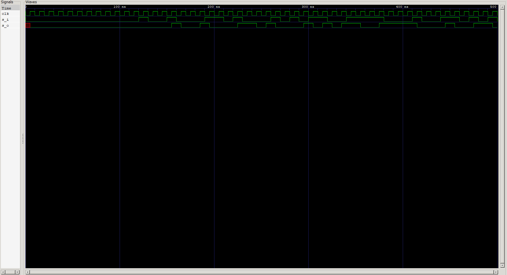

<div align="center">

# ➡️ SISO Shift Register

### 4-Bit Serial-In Serial-Out Shift Register · Verilog HDL

*Sequential Logic — [Verilog Fundamentals](#)*

[](#)
[](#)
[](#)
[](#)
[](#)
[](#)

</div>

---

## 📖 Overview

This project implements a **4-bit Serial-In Serial-Out (SISO) shift register** in Verilog HDL. Data enters **one bit at a time** through a single serial input `s_i`, marches through a chain of four D Flip-Flops on each clock edge, and emerges **one bit at a time** from a single serial output `s_o` — exactly **four clock cycles** after it went in.

Where the previous 4-bit register loaded all bits *in parallel*, the shift register moves data *sideways* through the chain: each flip-flop's output feeds the next flip-flop's input. It's the first project in this repository where **data flows through time**, not just across a single clock edge.

> A shift register is a delay line made of flip-flops — and the same idea underlies serial communication, data buffering, and sequence generation in real hardware.

This project also introduces a new Verilog construct, **`generate` with `genvar`**, to build the flip-flop chain without copy-pasting four near-identical instances, and pairs it with a fully **automated, self-checking testbench**.

**In this project you will:**

- 🔹 Build a 4-bit SISO shift register from chained D Flip-Flops
- 🔹 Learn `generate` / `genvar` for scalable structural design
- 🔹 Understand serial data movement and clock-cycle latency
- 🔹 Build a testbench that drives serial data on `negedge` and samples on `posedge`
- 🔹 Use a software reference shift register to predict expected output
- 🔹 Verify all 16 possible 4-bit serial patterns

---

## 📚 Prerequisites

| Topic | Why it matters |
|---|---|
| D Flip-Flop (`d_ff`) | The storage element chained 4× |
| 4-Bit Register (previous projects) | Parallel-load contrast to serial shifting |
| Structural Module Instantiation | Wires flip-flops output → input |
| Vectors & Bit-Selects | `q[i-1]`, `q[i]`, `q[3]` indexing |
| Clocked / Edge-Triggered Behavior | Data moves one stage per clock edge |
| Self-Checking Testbenches | Automated PASS/FAIL verification |

---

## 🧠 Theory

A **shift register** is a chain of flip-flops where the output of each stage feeds the input of the next, all sharing one clock. On every clock edge, every bit simultaneously moves one position down the chain.

In a **SISO** register:

- **Serial In** → one external input, `s_i`, feeds only the *first* flip-flop
- **Serial Out** → one external output, `s_o`, reads only the *last* flip-flop

With 4 flip-flops, a bit entered at `s_i` appears at `s_o` exactly **4 clock edges later**.

### Per-Stage Equations

$$q[0]_{next} = s\_i \qquad q[i]_{next} = q[i-1] \;\; (i = 1,2,3) \qquad s\_o = q[3]$$

In shift notation:

```verilog
q <= {q[2:0], s_i};   // conceptual behavior on every clock edge
```

---

## 🔬 Shift Behavior Example

Serial input stream (MSB first): `1 → 0 → 1 → 1`, starting from `q = 0000`:

| Clock Edge | `s_i` | `q[3:0]` | `s_o` (`q[3]`) |
|:-:|:-:|:-:|:-:|
| Initial | — | `0000` | 0 |
| 1 | 1 | `0001` | 0 |
| 2 | 0 | `0010` | 0 |
| 3 | 1 | `0101` | 0 |
| 4 | 1 | `1011` | **1** |
| 5 | 0 | `0110` | **0** |
| 6 | 0 | `1100` | **1** |
| 7 | 0 | `1000` | **1** |

Notice how the output stream `s_o` — `1, 0, 1, 1` at edges 4–7 — reproduces the input stream exactly, delayed by **4 clock cycles**.

```
Input stream  :  1 0 1 1 ─────────────▶
                          [ 4-cycle delay ]
Output stream :              ─────────────▶ 1 0 1 1
```

---

## 🔌 Block Diagram

```
                       4-BIT SISO SHIFT REGISTER
         ┌────────────────────────────────────────────────┐
         │                                                │
         │    ┌───────┐   ┌───────┐   ┌───────┐   ┌───────┐ │
  s_i ──▶│───▶│ D_FF0 │──▶│ D_FF1 │──▶│ D_FF2 │──▶│ D_FF3 │─│──▶ s_o
         │    └───┬───┘   └───┬───┘   └───┬───┘   └───┬───┘ │
         │     q[0]│        q[1]│        q[2]│        q[3]│   │
         │        ▲           ▲           ▲           ▲     │
  clk ───│────────┴───────────┴───────────┴───────────┘     │
         │                                                │
         └────────────────────────────────────────────────┘
```

Every flip-flop shares the **same clock**, so all four stages update simultaneously — each capturing what the *previous* stage held just before the edge.

---

## 💻 RTL Design

```verilog
module siso(
    input  s_i,
    input  clk,
    output s_o
);

    wire [3:0] q;

    // First stage: fed by the serial input
    d_ff dff1 (
        .d(s_i),
        .clk(clk),
        .q(q[0])
    );

    // Remaining stages: each fed by the previous stage's output
    genvar i;
    generate
        for (i = 1; i < 4; i = i + 1) begin : d_ff_gen
            d_ff dff (
                .d(q[i-1]),
                .clk(clk),
                .q(q[i])
            );
        end
    endgenerate

    // Serial output taken from the last stage
    assign s_o = q[3];

endmodule
```

| Element | Purpose |
|---|---|
| `input s_i` | Single serial data input |
| `output s_o` | Single serial data output, taken from the last stage |
| `wire [3:0] q` | Internal bus carrying every stage's output |
| `d_ff dff1 (.d(s_i), ...)` | First flip-flop, fed directly from the serial input |
| `generate … endgenerate` | Instantiates flip-flops 1–3 in a loop |
| `.d(q[i-1])` | Each stage's input is the previous stage's output |
| `assign s_o = q[3];` | Serial output is the last flip-flop's output |

---

## 💡 New Verilog Concept — `generate` and `genvar`

Writing four `d_ff` instances by hand (as in the earlier 4-bit register) works — but it doesn't scale. A **`generate` block** lets the compiler create hardware instances in a loop, **at elaboration time**:

```verilog
genvar i;
generate
    for (i = 1; i < 4; i = i + 1) begin : d_ff_gen
        d_ff dff ( .d(q[i-1]), .clk(clk), .q(q[i]) );
    end
endgenerate
```

<table>
<tr>
<td valign="top" width="50%">

**Key Rules**
- `genvar` declares a special loop variable that exists only at elaboration time
- The loop body **must** be inside a named `begin : label … end` block
- Each iteration creates a **separate, real hardware instance** — not a runtime loop

</td>
<td valign="top" width="50%">

**Why It Matters**
- Changing `i < 4` to `i < 8` yields an 8-bit shift register with no other edits
- Eliminates copy-paste errors in repetitive structures
- Foundation for parameterized, reusable RTL

</td>
</tr>
</table>

> ⚠️ **`generate` vs. a testbench `for` loop:** a `generate for` creates *hardware* (multiple module instances) when the design is built. A regular `for` inside an `initial` or `always` block creates *behavior* executed over simulated time. They look similar but do very different things.

---

## 🧪 Testbench Strategy

The testbench is fully automated and self-checking, built from four stages.

### Stage 1 — Flush the Register

The design has **no reset**, so flip-flops power up as unknown (`x`). The testbench pushes four `0`s through the chain to bring `q` into a known state:

```verilog
exp_q = 4'bxxxx;

repeat (4) begin
    @(negedge clk);
    s_i = 0;
    @(posedge clk);
    #1;
end

exp_q = 4'b0;   // reference model now matches the real hardware state
```

Four clocks are enough because the register is four stages deep — after four shifts, every `x` has been pushed out.

### Stage 2 — Sweep All 16 Patterns

```
2⁴ = 16 serial patterns   (0000 → 1111)
```

Each pattern is shifted in **MSB first**, one bit per clock:

```verilog
localparam total_test_cases = 2**4;   // 16

for (i = 0; i < total_test_cases; i = i + 1) begin
    test_data = i;
    for (j = 3; j >= 0; j = j - 1) begin
        @(negedge clk);
        s_i = test_data[j];
        @(posedge clk);
        exp_q = {exp_q[2:0], s_i};
        #1;
        exp_s_o = exp_q[3];
    end
    ...
end
```

### Stage 3 — Race-Free Timing

```
          negedge          posedge     +1 ns
             │                │          │
 drive s_i ──┘      DUT samples s_i      └── check s_o
```

| Step | Why |
|---|---|
| Drive `s_i` on **negedge** | Input is stable well before the active edge — no setup/hold race |
| Update reference on **posedge** | Reference model shifts at the same instant as the DUT |
| Wait `#1` before reading | Lets the flip-flop output settle after the clock edge |

### Stage 4 — Software Reference Model

```verilog
exp_q = {exp_q[2:0], s_i};   // shifts in software, mirroring the hardware
exp_s_o = exp_q[3];
```

A plain concatenation shift acts as an **independent golden model** — a completely different implementation of the same behavior than the DUT's chained flip-flops.

### Self-Checking

```verilog
if (exp_s_o == s_o)
    // PASS
else
    // FAIL — prints clk, s_i, expected, and received
```

A failure counter feeds the final summary:

```
RESULT : ALL VALID TEST CASES PASSED
```

---

## 🌊 Waveform Analysis



The waveform should show:

| Observation | What to look for |
|---|---|
| Flush phase | `s_i = 0` for the first four clocks while `q` settles from `x` to `0000` |
| Serial input | `s_i` changing once per clock, on the falling edge |
| Staggered propagation | Each bit appearing at `q[0]`, then `q[1]`, `q[2]`, `q[3]` one clock apart |
| Delay | `s_o` reproducing `s_i`'s pattern exactly **4 clock cycles later** |

The staircase-like propagation of a single `1` through `q[0] → q[1] → q[2] → q[3]` is the signature of a working shift register.

---

## 🔍 Verification Notes

<details>
<summary><b>🔎 What the testbench checks — and what it doesn't</b></summary>
<br>

The PASS/FAIL comparison runs **once per 4-bit pattern**, after the final bit is shifted in — at that moment `s_o` equals `test_data[3]`, so the check validates the full 4-stage path for that pattern.

The intermediate `s_o` values during the other three shifts of each pattern are tracked by the reference model (`exp_s_o` updates every clock) but are not individually compared. A stricter variant would move the `if (exp_s_o == s_o)` check *inside* the inner `j` loop, validating the output on every single clock edge — **64 comparisons instead of 16**.
</details>

<details>
<summary><b>🔎 Why the flush stage is necessary</b></summary>
<br>

Without a reset, the flip-flops start at `x` in simulation. If the reference model started at `0000` while the DUT started at `xxxx`, early comparisons would fail for the wrong reason. Flushing both with four known `0`s synchronizes the DUT and the reference model before real testing begins.
</details>

---

## 📂 Project Structure

```
xx_siso_shift_register/
├── README.md
├── siso.v          # RTL design (this module)
├── d_ff.v           # D Flip-Flop primitive (dependency)
├── siso_tb.v         # Automated self-checking testbench
└── waveform.png         # GTKWave capture
```

---

## ▶️ How to Run

```bash
# 1. Compile design + D-FF dependency + testbench
iverilog -o siso_tb.out siso.v d_ff.v siso_tb.v

# 2. Run the simulation
vvp siso_tb.out

# 3. View waveform in GTKWave
gtkwave waveform.vcd
```

A successful run ends with:

```
SISO Shift Register Automated Test Started
...
SISO Shift Regsiter Automated test Ended
RESULT : ALL VALID TEST CASES PASSED
```

---

## 🌟 Applications

<table>
<tr>
<td valign="top" width="50%">

**Communication & Data Movement**
- Serial data transmission
- Serial-to-parallel conversion building block
- Data buffering over a fixed number of clock cycles

</td>
<td valign="top" width="50%">

**Timing & Sequence Logic**
- Digital delay lines
- Pseudo-random sequence generators (LFSR basis)
- Synchronizer and pipeline stages

</td>
</tr>
</table>

---

## 🎯 Key Concepts Learned

<table>
<tr>
<td valign="top" width="50%">

**Design Concepts**
- Shift register operation
- Serial-in / serial-out data flow
- Fixed N-cycle propagation delay
- Chaining flip-flops output-to-input

</td>
<td valign="top" width="50%">

**Verilog & Verification**
- `generate` / `genvar` for scalable structure
- Named generate blocks (`begin : label`)
- Negedge-drive / posedge-sample testbench discipline
- Reset-less initialization by flushing
- Software shift-register reference model

</td>
</tr>
</table>

---

## 📝 Learning Notes

The big shift in this project was thinking about **time as a dimension of the design**. In the previous register, a value was loaded and held. Here, a single bit's journey takes four clock cycles — so correctness isn't just *"is the output right?"* but *"is the output right at the right clock edge?"*

Learning `generate` / `genvar` was the other key step. It was a clear first view of how Verilog scales structure: instead of copying a flip-flop instance four times, one loop describes the whole chain — and widening the register later becomes a one-number edit.

The testbench taught a useful discipline too: **drive on one edge, sample on the other**. Changing `s_i` on the falling edge and letting the DUT sample on the rising edge removes any chance of a timing race between the testbench and the design — a habit that carries into every clocked testbench from here on.

**Skills reinforced:**
- Reasoning across multiple clock cycles
- Scalable structural design with `generate`
- Race-free testbench timing
- Initializing reset-less designs safely
- Building an independent software reference model

---

## 💼 Interview Questions

<details>
<summary><b>1. What does SISO stand for, and how does data move through this register?</b></summary>
<br>

**Serial-In Serial-Out.** One bit enters per clock at `s_i`, shifts one flip-flop position on each clock edge, and reaches `s_o` after passing through all four stages.
</details>

<details>
<summary><b>2. How many clock cycles does it take for a bit to travel from <code>s_i</code> to <code>s_o</code>?</b></summary>
<br>

Four — one per flip-flop in the chain. In general, an N-bit SISO register has an N-cycle latency.
</details>

<details>
<summary><b>3. Why do all four flip-flops use the same clock?</b></summary>
<br>

So every stage shifts simultaneously. Each flip-flop captures the *previous* stage's value from just before the edge, which is what makes the data advance exactly one position per clock without bits being skipped or duplicated.
</details>

<details>
<summary><b>4. What is <code>genvar</code>, and how is it different from <code>integer</code> or <code>reg</code>?</b></summary>
<br>

`genvar` is a loop variable that exists only during **elaboration** — when the compiler builds the hardware structure. It can't hold a value at simulation time, unlike `integer` or `reg`.
</details>

<details>
<summary><b>5. What's the difference between a <code>generate for</code> loop and a <code>for</code> loop in a testbench?</b></summary>
<br>

A `generate for` creates multiple copies of **hardware** (module instances, assigns) when the design is elaborated. A procedural `for` inside `initial` or `always` runs as **behavior** over simulated time. One builds structure; the other executes statements.
</details>

<details>
<summary><b>6. Why does the generate block need a name (<code>begin : d_ff_gen</code>)?</b></summary>
<br>

Each loop iteration creates its own scope, and the label gives those instances unique hierarchical names (e.g., `d_ff_gen[1].dff`), which tools use for debugging and waveform signal naming.
</details>

<details>
<summary><b>7. Why does the testbench drive <code>s_i</code> on the negative edge but check results after the positive edge?</b></summary>
<br>

Driving on the opposite edge ensures `s_i` is stable long before the rising edge that the flip-flops sample on, avoiding setup/hold races. The `#1` delay after the posedge then lets the register outputs settle before they are read.
</details>

<details>
<summary><b>8. This design has no reset — how does the testbench handle that?</b></summary>
<br>

It shifts four `0`s through the chain before starting the real tests. Since the register is four stages deep, this flushes every unknown (`x`) value out and leaves `q = 0000`, matching the reference model's starting state.
</details>

<details>
<summary><b>9. How would you convert this into a serial-in parallel-out (SIPO) register?</b></summary>
<br>

Expose the internal `q[3:0]` bus as a 4-bit output port instead of just tapping `q[3]` — the shifting structure itself stays identical.
</details>

---

## 🚀 Next Project

### [SIPO Shift Register →](#)

Coming up:
- Serial-in, **parallel-out** behavior
- Exposing every stage as an output
- Serial-to-parallel data conversion
- Reusing the same `generate`-based chain

---

<div align="center">

## 👨‍💻 Author

**Padma Charan S S**

**Repository:** Verilog Fundamentals · **Approach:** Project-Driven Learning

### 🗺️ Repository Roadmap

```
Basic Verilog → Logic Gates → 7400 Series ICs → Combinational Circuits
     → Sequential Logic → RTL Design → FPGA Design → Computer Architecture → CPU Design
```

*Every project teaches one new concept through practical implementation.*

---

> *"A shift register is a conveyor belt made of flip-flops — every clock tick, every bit takes exactly one step forward."*

</div>